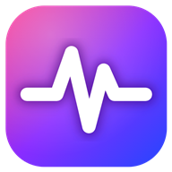
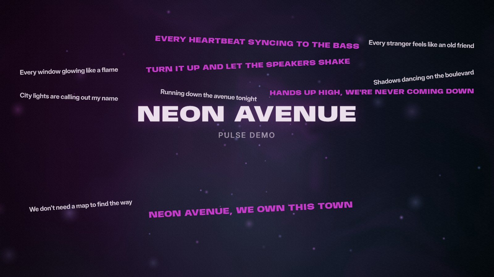
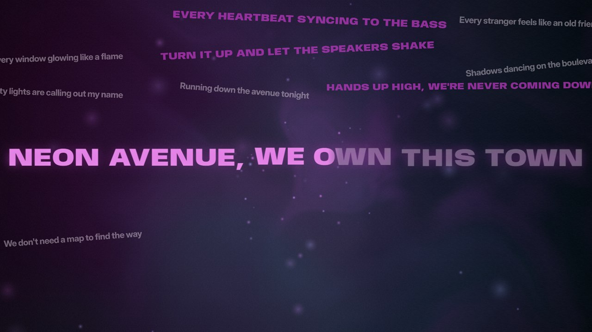
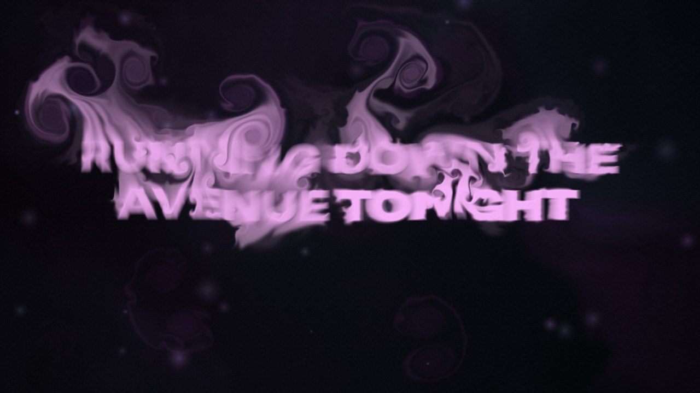
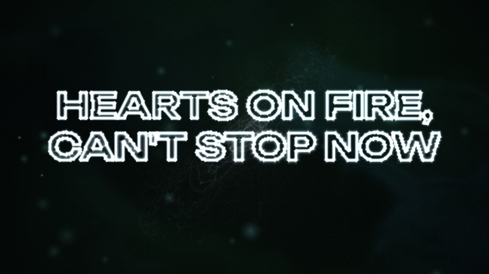

  

<h1 align="center">Pulse</h1>

  Lyrics that move with the music, for whatever you're playing on Spotify. 
  A free app for Windows 10 and 11, made by <a href="https://github.com/afeef-iniyavan">Afeef Iniyavan</a>.

  <a href="https://github.com/afeef-iniyavan/Pulse-Releases/releases/latest"><b>Download the latest version</b></a>

## What it does

Play a song in Spotify and open Pulse. The lyrics fill your screen in time with the singer, and
everything moves with the beat.

- **Every song looks different.** Pulse listens to the tempo and picks a look to match: flowing ink
  for slow songs, a growing collage for mid-tempo ones, a glowing beam for fast ones.
- **Songs build up.** Pulse finds the verses and choruses, so each chorus hits harder than the last.
- **No sign-in.** It works with Spotify Free or Premium. You don't need to connect any account.

## Scenes

| Song Portrait | Living Ink | Oscilloscope |
|---|---|---|
|  |  |  |
| Each line takes the stage, then joins a collage of the whole song. Choruses come back bigger. Press **P** at the end to save the picture. | Words pour in as glowing ink, and the drums stir it up. | A glowing beam traces each word as it's sung and shakes with the sound. |

There are also **Liquid Glass**, **Kinetic Poster**, **Shatter & Reform** and **Classic**. Press
**Tab** to choose a scene, or leave it on **Auto** and Pulse picks one for each song.

## Install

You need **Windows 10 or 11** (64-bit) and the **Spotify app for Windows**.

1. Open the [latest release](https://github.com/afeef-iniyavan/Pulse-Releases/releases/latest) and
   download **Pulse-Setup-…exe** under *Assets*.
2. Run it. Windows may show **"Windows protected your PC"**, because Pulse isn't signed with a paid
   certificate. Click **More info**, then **Run anyway**.
3. Pulse installs in a few seconds and opens fullscreen (press **F** for a window). It's in your
   Start menu and on your desktop.

Then play something in Spotify.

## Updates

You only download Pulse once. When a new version comes out, Pulse downloads it in the background
and installs it the next time you close Pulse. Press **U** to install it straight away.

## Shortcuts

| Key | What it does |
|---|---|
| Tab | Choose a scene |
| F | Fullscreen on / off |
| ← / → | Move the lyrics earlier / later by 0.1 s if they're out of time (remembered for each song) |
| Space | Play / pause |
| N / B | Next / previous song |
| P | Save the Song Portrait to your Pictures\Pulse folder |
| X | Flashing effects: mild, full or off |
| H | Hide / show the song info |
| ? | Show all shortcuts |

## Privacy

- To find lyrics, Pulse sends the song's **title, artist, album and length** to
  [LRCLIB](https://lrclib.net), a free lyrics database. Nothing else about you or your music leaves
  your PC.
- Pulse listens to your PC's sound to follow the beat. The sound is analysed on your PC as it plays.
  It's **never recorded or sent anywhere**.
- To check for updates, Pulse reads a small file from this page. Nothing about you is sent.

## If something's not right

- **"No lyrics found":** LRCLIB doesn't have timed lyrics for that song yet. Pulse shows the album
  cover with a visualizer instead.
- **Lyrics slightly early or late:** use ← / →. Bluetooth headphones add a delay, so they often
  need a nudge.
- **Pulse doesn't show the song:** make sure it's playing in the Spotify app for Windows, then give
  Pulse a few seconds.

## Uninstall

**Settings → Apps → Installed apps → Pulse → Uninstall.**

---

Pulse is made by <a href="https://github.com/afeef-iniyavan">Afeef Iniyavan</a>. It's an independent app, not made by or
affiliated with Spotify. Lyrics come from LRCLIB. The songs in these screenshots are Pulse's own
demo songs.
